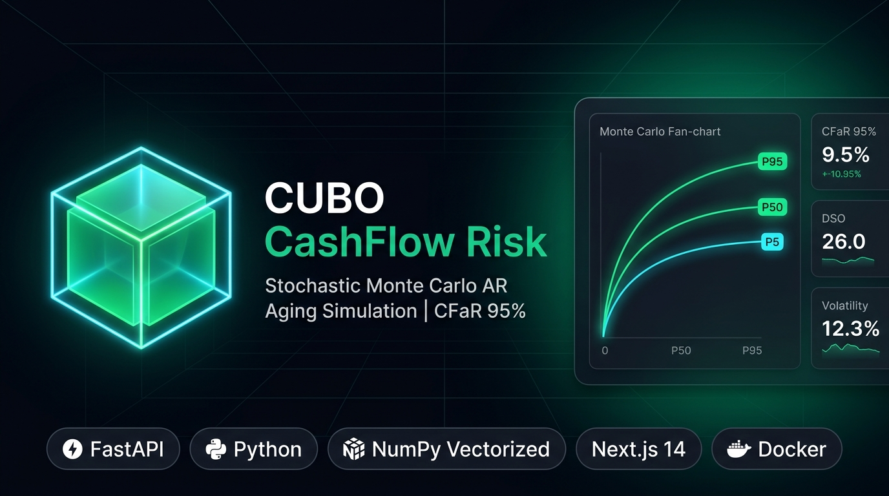
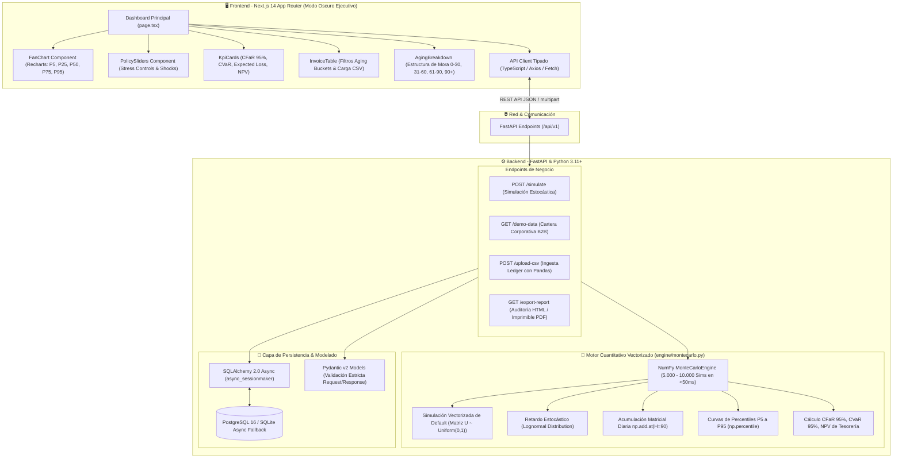

# CUBO CashFlow Risk 📊⚡
### Quantitative Treasury & Stochastic AR Aging Cash Flow Simulation SaaS Platform

[](https://fastapi.tiangolo.com)
[](https://nextjs.org)
[](https://numpy.org)
[](https://www.docker.com)
[]()

<p align="center">
  
</p>

---

## 1. Visión Ejecutiva del Producto

**CUBO CashFlow Risk** es una solución SaaS B2B de ingeniería cuantitativa diseñada para directores de finanzas (CFO), tesoreros corporativos y comités de riesgo de crédito. Transforma la gestión tradicional y estática de cuentas por cobrar (*Accounts Receivable Aging*) en una **proyección dinámica estocástica de flujo de fondos** mediante simulaciones de Monte Carlo vectorizadas en **NumPy**.

En lugar de proyectar ingresos basados en fechas teóricas de vencimiento, la plataforma simula **5.000 a 10.000 trayectorias simultáneas** a un horizonte de 90 días, incorporando:
- **Shocks macroeconómicos de incumplimiento** (Multiplicador de Probabilidad de Default $PD$).
- **Dispersión estocástica del tiempo de cobranza** mediante distribuciones log-normales de retraso.
- **Métricas institucionales de liquidez extrema**: *Cash Flow at Risk* ($CFaR_{95\%}$), *Conditional Value at Risk* ($CVaR_{95\%}$ / *Expected Shortfall*) e *Incobrabilidad Esperada*.
- **Reportes ejecutivos auditables** con un solo clic para comités de crédito y directores de banca corporativa.

---

## 2. Diagrama de Arquitectura del Sistema



---

## 3. Fundamentos de la Metodología Cuantitativa

### 3.1. Shock de Probabilidad de Default ($PD^*$)
Para cada factura $i$, la probabilidad base de default $PD_i$ (calibrada por rating crediticio AAA, AA, A, BBB o High Risk y tramo de mora) es estresada por el factor macroeconómico $\alpha_{\text{stress}}$:
$$PD_i^* = \min\left(0.999, PD_i \times \alpha_{\text{stress}}\right)$$

### 3.2. Retardo Estocástico de Pago ($\tau_{s, i}$)
Para cada trayectoria $s \in \{1, \dots, S\}$ y cada factura $i$, el retraso sobre el vencimiento contractual se modela mediante una distribución Log-Normal calibrada:
$$\tau_{s, i} \sim \text{Lognormal}\left(\mu_{i}, \sigma^2\right)$$
$$\text{donde } \mu_i = \ln\left(\text{delay\_días}_i + \Delta_{\text{macro}}\right) - \frac{\sigma^2}{2}$$

### 3.3. Cash Flow at Risk ($CFaR_{95\%}$)
El Cash Flow at Risk al 95% de nivel de confianza representa la pérdida máxima de liquidez respecto a la mediana del escenario base:
$$CFaR_{95\%} = P50_{\text{final}} - P5_{\text{final}}$$

### 3.4. Conditional VaR / Expected Shortfall ($CVaR_{95\%}$)
Representa la esperanza condicional de recaudación en el $5\%$ de las peores realizaciones de mercado:
$$CVaR_{95\%} = \mathbb{E}\left[C_{90} \mid C_{90} \le P5_{\text{final}}\right]$$

---

## 4. Estructura del Monorepo

```text
cubo-cashflow-risk/
├── backend/
│   ├── app/
│   │   ├── api/
│   │   │   └── routes.py          # Endpoints REST (/simulate, /demo-data, /upload-csv, /export-report)
│   │   ├── core/
│   │   │   └── config.py          # Configuración Pydantic Settings y variables de entorno
│   │   ├── engine/
│   │   │   └── montecarlo.py      # Motor vectorizado en NumPy (5.000 simulaciones a 90 días)
│   │   ├── models/
│   │   │   └── schemas.py         # Modelos Pydantic v2 para validación estricta
│   │   ├── db/
│   │   │   └── models.py          # Tablas SQLAlchemy asíncronas con fallback automático
│   │   └── main.py                # Instancia de FastAPI, middlewares CORS y lifespan
│   ├── demo_invoices_sample.csv   # Dataset de prueba para ingesta masiva
│   ├── requirements.txt           # Dependencias científicas (NumPy, SciPy, Pandas, FastAPI)
│   └── Dockerfile                 # Imagen Docker optimizada para Python 3.11-slim
├── frontend/
│   ├── src/
│   │   ├── app/
│   │   │   ├── globals.css        # Variables de diseño y tema oscuro ejecutivo
│   │   │   ├── layout.tsx         # Raíz de la aplicación Next.js
│   │   │   └── page.tsx           # Dashboard principal interactivo de tesorería
│   │   ├── components/
│   │   │   ├── FanChart.tsx       # Gráfico de abanico de percentiles Recharts (P5..P95)
│   │   │   ├── PolicySliders.tsx  # Panel interactivo de estrés cuantitativo y shocks
│   │   │   ├── KpiCards.tsx       # Tarjetas ejecutivas de CFaR, CVaR, Exposición y Mora
│   │   │   ├── AgingBreakdown.tsx # Desglose por tramos de morosidad (Current, 1-30, 31-60, 90+)
│   │   │   └── InvoiceTable.tsx   # Ledger interactivo con filtros y carga de CSV
│   │   └── lib/
│   │       └── api.ts             # Cliente TypeScript tipado con fallback offline
│   ├── package.json
│   ├── next.config.js
│   ├── tailwind.config.js
│   └── Dockerfile                 # Construcción multi-etapa Next.js standalone
├── docker-compose.yml             # Orquestador multi-contenedor (db, backend, frontend)
└── README.md                      # Documentación arquitectónica y comercial
```

---

## 5. Puesta en Marcha Rápida (Quickstart)

### Opción A: Despliegue en un solo comando con Docker Compose (Recomendado para Producción)

Requisitos: Tener instalado [Docker](https://www.docker.com/) y Docker Compose.

```bash
# 1. Clonar o acceder a la raíz del proyecto
cd cubo-cashflow-risk

# 2. Levantar la base de datos PostgreSQL, el backend FastAPI y el frontend Next.js
docker-compose up --build
```

Una vez levantados los contenedores:
* **Frontend Dashboard Ejecutivo:** [http://localhost:3000](http://localhost:3000)
* **Backend API & Swagger Docs:** [http://localhost:8000/docs](http://localhost:8000/docs)
* **Base de Datos PostgreSQL:** Puerto `5432` (`user: cubo_user`, `password: cubo_password`)

---

### Opción B: Ejecución en Entorno Local (Desarrollo)

#### 1. Levantar el Backend (FastAPI)
```bash
cd backend
python -m venv venv

# En Windows:
venv\Scripts\activate
# En Linux/macOS:
source venv/bin/activate

pip install -r requirements.txt
uvicorn app.main:app --reload --port 8000
```
> **Nota:** Si PostgreSQL no se encuentra activo localmente, el backend activa automáticamente su motor de persistencia SQLite asíncrono (`cubo_cashflow.db`) sin interrumpir la operación.

#### 2. Levantar el Frontend (Next.js 14)
```bash
cd frontend
npm install
npm run dev
```
Abrí [http://localhost:3000](http://localhost:3000) en tu navegador.

---

## 6. Endpoints Principales de la API REST

| Método | Endpoint | Descripción |
| :--- | :--- | :--- |
| `POST` | `/api/v1/simulate` | Ejecuta la simulación de Monte Carlo (5.000 trayectorias a 90 días) y retorna métricas de riesgo y curvas de percentiles. |
| `GET` | `/api/v1/demo-data` | Retorna una cartera B2B institucional de muestra diversificada por ratings crediticios y sectores. |
| `POST` | `/api/v1/upload-csv` | Carga e ingesta automática de balances de clientes en formato CSV/Excel con detección inteligente de columnas. |
| `GET` | `/api/v1/export-report` | Genera un informe cuantitativo en formato HTML imprimible/PDF para comités de auditoría y crédito. |
| `GET` | `/api/v1/health` | Diagnóstico de salud del servicio y comprobación de latencia. |

---

## 7. Licencia & Créditos

**CUBO CashFlow Risk** es una arquitectura propietaria desarrollada bajo estándares de ingeniería cuantitativa y FinTech B2B de clase mundial.
